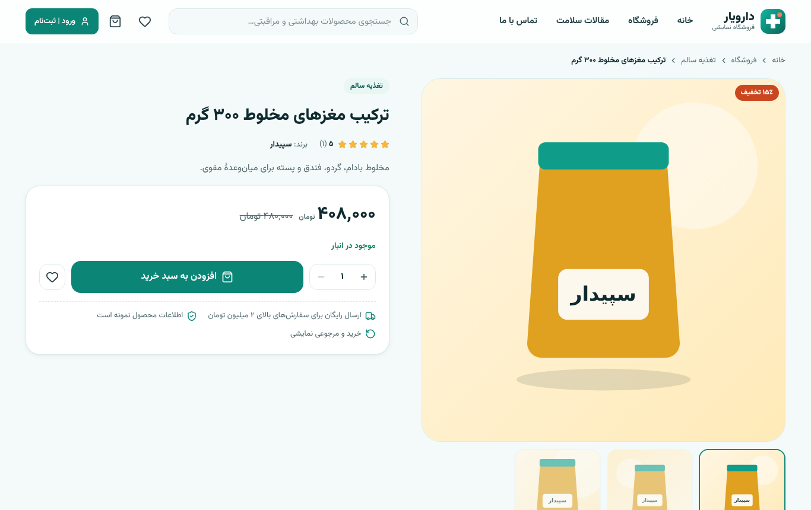
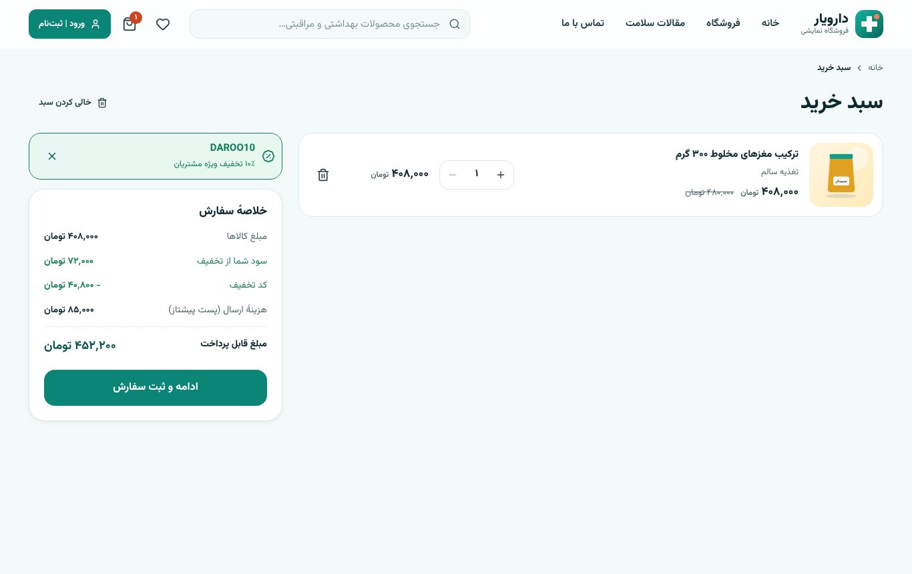
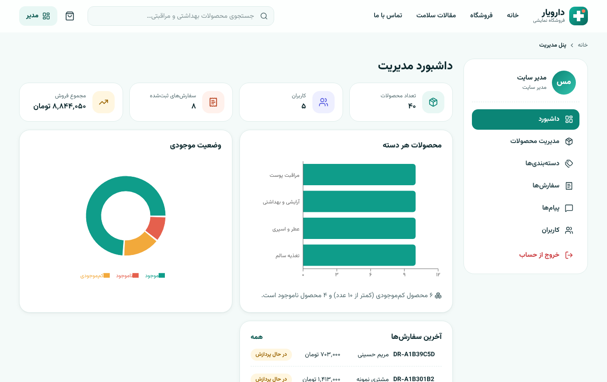

# دارویار

فروشگاه آنلاین نمایشی محصولات بهداشتی و مراقبتی؛ فرانت‌اند React و TypeScript با رابط فارسی راست‌به‌چپ و یک API آزمایشی مستقل (Express + json-server).

**[مشاهدهٔ دمو](https://mohamadreza-21.github.io/daroyar-demo/)**

> همهٔ محصولات، قیمت‌ها، کاربران و سفارش‌ها ساختگی‌اند. پرداخت و ارسال واقعی وجود ندارد؛ اطلاعات شخصی یا گذرواژهٔ واقعی وارد نکنید.

| صفحهٔ اصلی                          | فروشگاه                            | جزئیات محصول                             |
| ---------------------------------- | ---------------------------------- | ---------------------------------------- |
|  |  |  |

| سبد خرید                           | تسویه‌حساب                                 | جزئیات سفارش                                |
| ---------------------------------- | ------------------------------------------ | ------------------------------------------- |
|  |  |  |

| پنل مدیر                             | موبایل                                      | خطای شبکه                                    |
| ------------------------------------ | ------------------------------------------- | -------------------------------------------- |
|  |  |  |

## امکانات

- **فروشگاه:** جست‌وجوی فارسی (یکسان‌سازی «ي/ك»، نیم‌فاصله و ارقام فارسی/عربی)، فیلتر دسته و قیمت، فقط موجود، فقط تخفیف‌دار، مرتب‌سازی و صفحه‌بندی سمت سرور
- **محصول:** گالری، قیمت و تخفیف، موجودی، ثبت نظر و امتیاز، محصولات مشابه
- **سبد و سفارش:** سبد جدا برای مهمان و کاربر، کد تخفیف (`DAROO10`، `SALAMAT15`)، سقف ۹۹ عدد برای هر کالا و ۵۰ کالای متفاوت (یکسان در سبد و سرور)، بررسی قیمت و موجودی در سرور، کسر موجودی و لغو سفارش با بازگشت موجودی
- **حساب کاربری:** ورود و ثبت‌نام، پروفایل، علاقه‌مندی‌ها، سفارش‌ها، پیام‌ها، نشست با انقضا
- **پنل مدیریت:** CRUD محصولات و دسته‌ها، سفارش‌ها با گذارهای مجاز وضعیت، پاسخ به پیام‌ها، کاربران، نمودارهای آمار
- **تجربهٔ کاربری:** واکنش‌گرا، اسکلت بارگذاری، حالت خطای شبکه با «تلاش دوباره»، وضعیت جست‌وجو و فیلتر در آدرس
- **SEO:** متای هر صفحه، Open Graph و Twitter Card، JSON-LD (WebSite، Organization، Product، Article، BreadcrumbList، ItemList)، صفحه‌های HTML ایستا با محتوای قابل خزش و لینک داخلی برای محصولات و مقالات، `sitemap.xml` (با تصاویر و تاریخ انتشار)، `robots.txt`، `manifest.webmanifest` و آیکون‌ها

## فناوری‌ها

React 19، TypeScript (حالت strict)، Vite، Tailwind CSS 4، React Router، TanStack Query، Zustand، React Hook Form + Zod، Axios، Framer Motion، Swiper، Recharts، Express + json-server

## معماری

هر feature چهار لایهٔ جدا دارد و ESLint مرز آن‌ها را اجبار می‌کند:

| لایه                                | مسئولیت                                                                        |
| ----------------------------------- | ------------------------------------------------------------------------------ |
| `domain/`                           | منطق کسب‌وکار خالص: قوانین، اسکیماها، محاسبات؛ بدون React و HTTP               |
| `data/`                             | درخواست‌ها (`api.ts`)، کش و mutation (`queries.ts`)، وضعیت سراسری (`store.ts`) |
| `hooks/`                            | مدل نمای هر صفحه؛ داده، دامنه، فرم، URL و SEO را ترکیب می‌کند                  |
| `components/` `pages/` `shared/ui/` | فقط رندر JSX؛ دسترسی مستقیم به لایهٔ data ممنوع است                             |

کد کاملاً تابعی است (بدون `class` و `this`) و importها با alias `@/` به `src/` اشاره می‌کنند.

```
src/
  app/        مسیرها، Guardها و پیش‌بارگذاری داده
  features/   account admin articles auth cart catalog contact home orders wishlist
  shared/     data domain hooks seo ui
  styles/     Tailwind و توکن‌های طراحی
server/       API آزمایشی: routes، lib، seed
plugins/      پلاگین‌های Vite: SEO، پیش‌بارگذاری فونت و مسیرها
```

### بهینه‌سازی

- تقسیم کد هر صفحه و کامپوننت‌های تعاملی (سبد، منو، فرم‌ها، دیالوگ‌ها) با `lazy` و بارگذاری در اولین استفاده
- پیش‌بارگذاری فونت، کد مسیر و داده‌های صفحه هم‌زمان با بستهٔ اصلی
- اسلایدر صفحهٔ اصلی با CSS خالص برای LCP سریع و بدون جابه‌جایی چیدمان
- هدر کش بلندمدت برای `/assets/*` در `public/_headers`

## اجرا

نیازمند Node.js نسخهٔ `22.22.0` یا بالاتر.

```bash
npm install
npm run dev
```

API روی پورت `3001` و فرانت روی `5173` اجرا می‌شود و درخواست‌های `/api` از طریق پروکسی Vite به API می‌رسند.

| فرمان                  | کار                                |
| ---------------------- | ---------------------------------- |
| `npm run dev`          | اجرای API و فرانت با هم            |
| `npm run server:reset` | بازگرداندن داده‌های نمونه          |
| `npm run seed`         | بازتولید `server/db.json` و تصاویر |
| `npm run typecheck`    | بررسی نوع فرانت و سرور             |
| `npm run lint`         | ESLint شامل قوانین لایه‌ها         |
| `npm run build`        | ساخت نسخهٔ تولید در `dist/`         |
| `npm run preview`      | پیش‌نمایش نسخهٔ ساخته‌شده           |

### متغیرهای محیطی

نمونه در `.env.example`:

| متغیر           | کاربرد                                         |
| --------------- | ---------------------------------------------- |
| `VITE_SITE_URL` | آدرس سایت برای canonical، sitemap و Open Graph |
| `VITE_API_URL`  | آدرس API در build (پیش‌فرض `/api`)             |

متغیرهای سرور: `PORT`، `API_DELAY` (تأخیر مصنوعی به میلی‌ثانیه)، `SESSION_TTL_MINUTES`.

## حساب‌های نمایشی

| نقش          | نام کاربری                         | گذرواژه       |
| ------------ | ---------------------------------- | ------------- |
| مشتری        | `customer`                         | `customer123` |
| مدیر         | `admin`                            | `admin1234`   |
| کاربران دیگر | `sara.rad` `ali.karimi` `maryam.h` | `demo1234`    |

## استقرار

فرانت یک سایت استاتیک است و مسیرها باید به `index.html` بازنویسی شوند (`public/_redirects` برای Netlify آماده است). API را جداگانه با `npm run server` اجرا کنید و `VITE_API_URL` را هنگام build روی آدرس آن بگذارید.

## محدودیت‌ها

- json-server فقط برای نمایش است: داده‌ها در فایل `server/.data/db.json` ذخیره می‌شوند و همزمانی و تراکنش واقعی ندارند.
- نشست در `localStorage` نگه‌داری می‌شود؛ کنترل واقعی دسترسی در سرور انجام می‌شود و Guardهای فرانت فقط برای تجربهٔ کاربری‌اند.
- HTTPS، CSRF، بازیابی گذرواژه و تأیید ایمیل پیاده‌سازی نشده است؛ پرداخت شبیه‌سازی می‌شود و فرم تماس ایمیل نمی‌فرستد.
- برنامه SPA است؛ برای وابستگی جدی به موتورهای جست‌وجو پیش‌رندر یا SSR لازم است.

## مجوز

[MIT](LICENSE)
